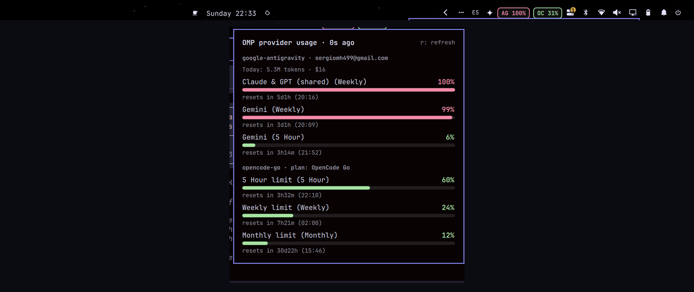

# OMP Usage for Omarchy

Live [Oh My Pi](https://github.com/github-can1357/oh-my-pi) provider usage in the Omarchy status bar: one chip per connected provider showing how much of its plan limits is consumed, with a popup panel for the full breakdown.



## Features

- **One bar chip per provider** — `AG 100%`, `OC 26%` … the percentage is the provider's most-consumed limit (5-hour / weekly / monthly / daily windows), tinted by status: green below 80%, amber below 98%, red at exhaustion.
- **Fully dynamic** — the provider list comes from `omp usage --json` and your OMP stats database, nothing is hardcoded. Log in a new provider with `omp login` and its chip appears on the next refresh. Providers that burn tokens but report no limits still show up in the popup.
- **Popup panel** (left click) — per provider: plan name or account email, today's token count and USD cost, every usage limit as a progress bar with percentage, relative reset countdown and exact local reset time.
- **Tooltip** (hover) — one line per provider: worst limit, window and reset countdown, today's tokens.
- **Degraded states stay honest** — a failing `omp usage` shows an error line and keeps the last good data; a provider without limits is labeled instead of guessed.

## Requirements

- Omarchy shell (Quickshell)
- Oh My Pi (`omp`) available on your `PATH`
- At least one authenticated OMP provider (`omp login <provider>`)

## Install

```sh
omarchy plugin add https://github.com/sergiomh499/omp-usage.git --enable
omarchy restart shell
```

## Update

```sh
omarchy plugin update sergiomh499.omp-usage --yes
omarchy restart shell
```

## Removal

```sh
omarchy plugin remove sergiomh499.omp-usage
omarchy restart shell
```

## Interactions

| Action | Result |
|---|---|
| Left click | Open/close the popup panel |
| Middle / right click | Force refresh |
| `r` (popup open) | Force refresh |
| `q` / `Esc` (popup open) | Close |

IPC (e.g. for Hyprland keybindings):

```sh
omarchy-shell sergiomh499.omp-usage toggle
omarchy-shell sergiomh499.omp-usage open
omarchy-shell sergiomh499.omp-usage close
```

## Configuration

`~/.config/omarchy/shell.json`, on the widget's bar entry:

| Key | Type | Default | Description |
|---|---|---|---|
| `refreshSec` | integer (30–3600) | `60` | Poll interval for `omp usage` and the daily token stats |

## Data sources

Both come from Oh My Pi itself, read-only:

- `omp usage --json` — live plan/limit snapshots per authenticated provider (windows, percentages, reset timestamps, plan name).
- `~/.omp/stats.db` — today's token and cost totals per provider.

## Development

Edits to `Usage.qml` hot-reload the plugin; if a burst of saves ever stalls the watcher, `omarchy restart shell` guarantees a clean load. Validate the manifest with:

```sh
omarchy plugin validate ~/.config/omarchy/plugins/sergiomh499.omp-usage
```

## License

MIT © sergiomh499
